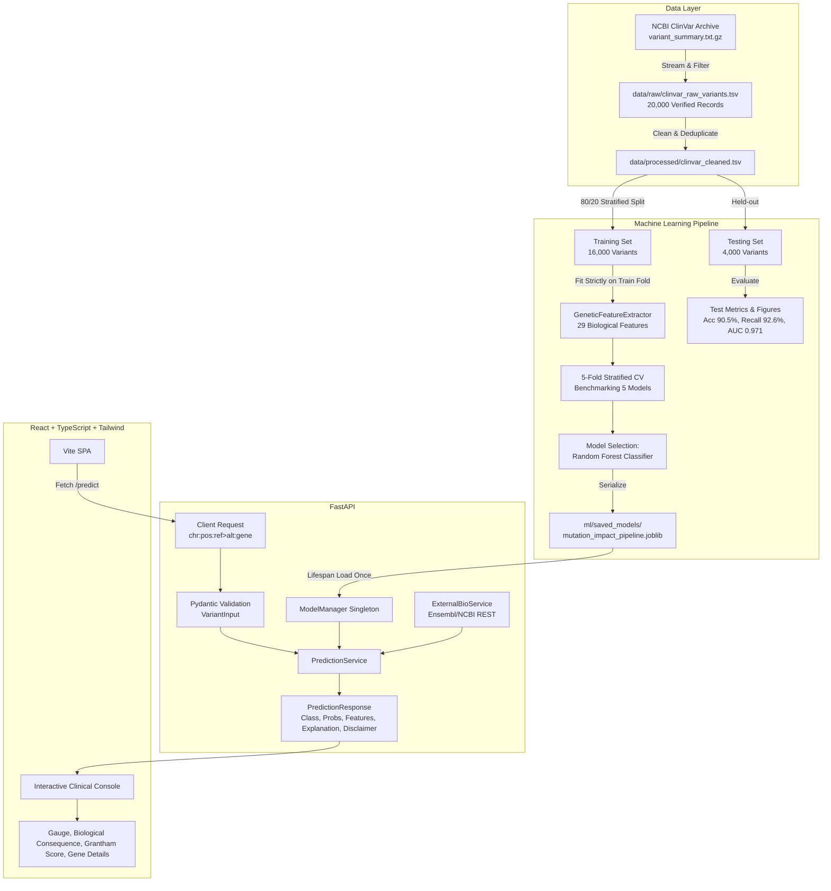

# Mutation Impact AI — System Architecture

**AI-Based Prediction of Functional Impact of SNPs and Genetic Mutations**

---

## 1. Architectural Overview

Mutation Impact AI is an end-to-end, scientifically grounded computational genomics platform designed to predict whether human genetic variants (single nucleotide variants, indels, insertions, deletions) exhibit **Benign** or **Pathogenic** clinical impact.



---

## 2. Directory Structure

```text
Mutation Projec/
├── .gitignore                          # Clean tracking rules
├── README.md                           # Comprehensive documentation & setup
├── backend/
│   ├── app/
│   │   ├── __init__.py
│   │   ├── main.py                     # FastAPI entry point, CORS, static SPA mount
│   │   ├── api/
│   │   │   ├── __init__.py
│   │   │   ├── routes.py               # REST API endpoints (/predict, /model/info, etc.)
│   │   │   └── schemas.py              # Pydantic input/output schemas
│   │   ├── core/
│   │   │   ├── __init__.py
│   │   │   ├── config.py               # Application configuration & paths
│   │   │   └── model_loader.py         # Singleton model lifecycle manager
│   │   └── services/
│   │       ├── __init__.py
│   │       ├── external_bio.py         # Ensembl / NCBI REST integration & cache
│   │       └── prediction_service.py   # Inference logic & biological explanations
│   ├── requirements.txt                # Python backend dependencies
│   └── tests/
│       ├── __init__.py
│       └── test_api.py                 # 10 integration tests for FastAPI
├── data/
│   ├── raw/
│   │   ├── clinvar_raw_variants.tsv    # Raw authentic ClinVar extract (20,000 records)
│   │   └── download_metadata.json      # Provenance timestamp, URL & filtering criteria
│   └── processed/
│       ├── clinvar_cleaned.tsv         # Cleaned, standardized modeling dataset
│       └── dataset_summary.json        # Class breakdown, chromosome counts & top genes
├── docs/
│   ├── API.md                          # Endpoint schemas and examples
│   ├── ARCHITECTURE.md                 # System architecture documentation
│   └── DATASET.md                      # Clinical significance mapping & data hygiene
├── frontend/
│   ├── index.html                      # HTML5 root with scientific typography
│   ├── package.json                    # Frontend dependencies (React 18, Vite, Tailwind)
│   ├── postcss.config.js               # PostCSS configuration
│   ├── tailwind.config.js              # Biotechnology scientific design tokens
│   ├── tsconfig.json                   # Strict TypeScript configuration
│   ├── vite.config.ts                  # Vite configuration with API proxying
│   ├── dist/                           # Compiled production SPA assets
│   └── src/
│       ├── App.tsx                     # Primary application layout and state manager
│       ├── index.css                   # Custom scrollbars, focus rings & Tailwind base
│       ├── main.tsx                    # React DOM entry point
│       ├── components/
│       │   ├── Footer.tsx              # Scientific disclaimer, citations & resources
│       │   └── Header.tsx              # Clinical header with real-time API status
│       ├── pages/
│       │   ├── AboutPage.tsx           # Methodology, ACMG/AMP alignment, citations
│       │   ├── DashboardPage.tsx       # Executive overview, live presets, verified stats
│       │   ├── DatasetPage.tsx         # Data provenance, hygiene & chromosome breakdown
│       │   ├── ModelPerformancePage.tsx# 5-model comparative benchmark & figure tabs
│       │   └── PredictPage.tsx         # Interactive clinical inference console
│       ├── services/
│       │   └── api.ts                  # Typed client service communicating with backend
│       └── types/
│           └── index.ts                # TypeScript interfaces for API payloads
├── ml/
│   ├── __init__.py
│   ├── download_clinvar.py             # Reproducible streaming extractor for ClinVar
│   ├── preprocess.py                   # GeneticFeatureExtractor & MutationImpactPipeline
│   ├── train.py                        # 5-model training, 5-fold CV & figure generator
│   └── saved_models/
│       ├── metrics.json                # Verified evaluation metrics for all 5 models
│       ├── model_metadata.json         # Classifier parameters & Gini feature importances
│       ├── mutation_impact_pipeline.joblib # Serialized Scikit-learn pipeline
│       └── figures/                    # Publication-grade evaluation figures
│           ├── confusion_matrix.png
│           ├── feature_importance.png
│           ├── model_comparison.png
│           ├── precision_recall_curve.png
│           └── roc_curve.png
└── tests/
    └── test_ml_pipeline.py             # Feature extractor & inference unit tests
```

---

## 3. Data Flow & Security Principles

1. **Zero Data Leakage:**
   - Raw ClinVar metadata (review status, submitter count, submission dates, clinical significance) are **strictly isolated** from model features.
   - All scalers, transformers, and empirical Bayes gene priors are fitted strictly on the training partition ($N = 16,000$).
2. **Single-Pass In-Memory Inference:**
   - Model is loaded once into memory upon FastAPI server startup. No models are trained or pickled during HTTP requests.
3. **Graceful External Degradation:**
   - External gene annotations (Ensembl / NCBI) are queried with strict 2-second timeout limits and cached in-memory. If remote APIs fail or timeout, the system falls back gracefully to curated human disease gene profiles without failing the prediction.
